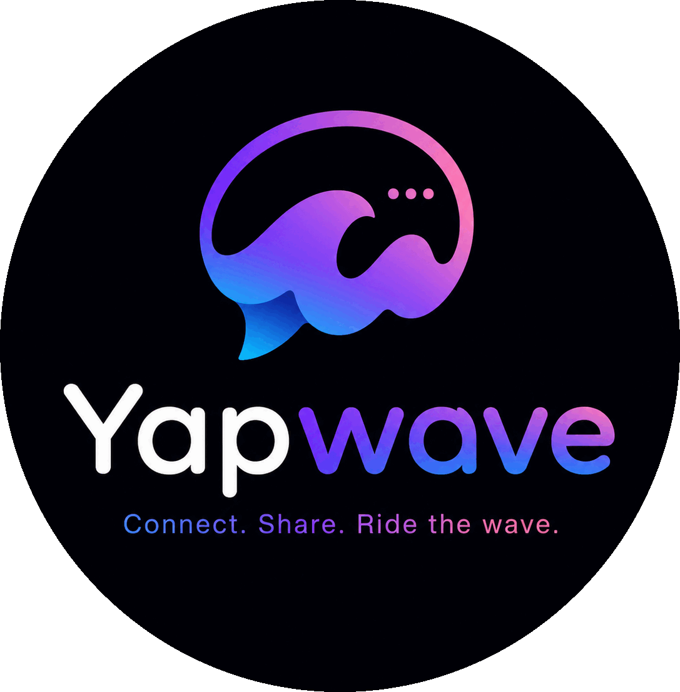
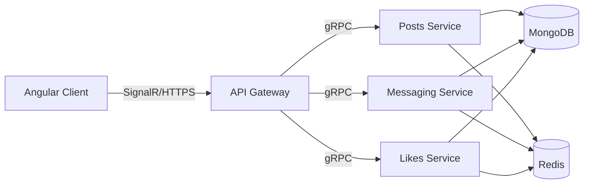

<p align="center">  </p>

# Yapwave


A social app, built on Angular, .NET, and a gRPC-based microservices backend.

## About

Yapwave is a personal project built to get hands on with a service oriented architecture end to end: independently deployable backend services, real time client updates, and a fully containerized deployment pipeline, instead of a single monolithic CRUD app. It's a learning-focused build, not a finished product, see Roadmap below for current status.

## Features

- **Posts** - create, view, and interact with a feed
- **Messaging** - direct messages delivered in real time
- **Likes** - react to posts with live count updates

## Tech Stack

| Layer | Technology |
|---|---|
| Frontend | Angular |
| Backend | .NET (ASP.NET Core) |
| Service-to-service | gRPC |
| Real-time push | SignalR |
| Database | MongoDB |
| Cache / pub-sub | Redis |
| Containerization | Docker |
| Orchestration | Kubernetes |
| CI/CD | GitHub Actions |

## Architecture

Backend is split into independent services — Posts, Messaging, and Likes — communicating over gRPC and persisting to MongoDB. Redis handles caching and real-time fan-out. SignalR pushes live updates (new messages, live like counts) to the Angular client. Every service is containerized and deployed to Kubernetes.



## Project Structure (planned)

```
yapwave/
├── client/                  # Angular app
├── services/
│   ├── posts/                # Posts microservice (.NET)
│   ├── messaging/             # Messaging microservice (.NET)
│   └── likes/                  # Likes microservice (.NET)
├── protos/                   # gRPC contract definitions
├── k8s/                          # Kubernetes manifests
├── docker-compose.yml
└── .github/workflows/         # CI/CD pipelines
```

## Getting Started

Prerequisites:
- .NET SDK 8+
- Node.js + Angular CLI
- Docker
- kubectl (for local Kubernetes - Minikube or Kind)

Setup and run instructions will be added as each service is implemented.

## Roadmap

- [ ] Auth
- [ ] Posts service
- [ ] Messaging service (real-time)
- [ ] Likes service
- [ ] Redis caching / pub-sub
- [ ] Dockerize all services
- [ ] Kubernetes manifests
- [ ] CI/CD pipeline

## License

MIT [LICENSE](LICENSE.md)
